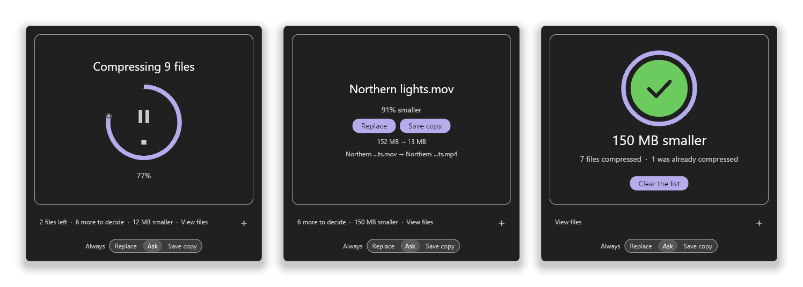
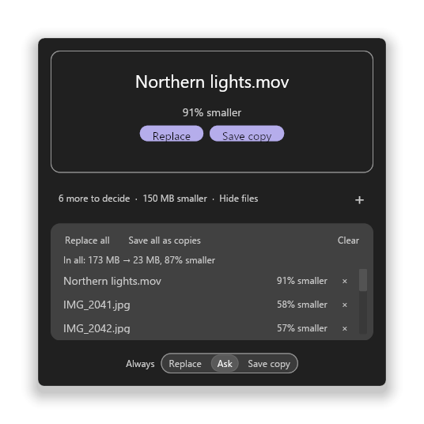

<div align="center">


# Gracil

**Smaller videos and photos that look exactly the same.**

A small, free Windows 11 app. Drop files in, and Gracil works out how far each one can be
compressed before anyone could tell the difference. Then you choose whether to keep it.

[**Download for Windows 11**](https://github.com/alexpaltrc/gracil/releases/latest) ·
[How it works](docs/how-gracil-works.md) · [Questions](docs/faq.md)



</div>

## Why Gracil

🎯 **Every video gets its own amount of compression.** A still interview can lose far more than
a football match before it shows. So Gracil doesn't squeeze every file the same. It compresses a
few short moments of each video at several strengths and measures them with VMAF, the standard
used by streaming services. Then it picks the strongest one that still scores 95: the point where
people watching normally see no difference. Photos are measured the same way, with SSIMULACRA2,
and made with jpegli, Google's modern JPEG compressor.

🛡️ **Your original is safe.** Gracil never writes over a file while it works. You see the result
first, `120 MB → 78 MB`, and choose **Replace** or **Save copy**. A replaced file keeps its name
and creation date, so it still sorts in the same place. If the result wouldn't be clearly
smaller, there is no result to choose. If anything goes wrong, even a power cut, your original is
put back.

🌙 **It never gets in the way.** Gracil runs below your other programs and never uses more than
half the processor while you work. Its tools run in Windows' efficiency mode. It holds the
graphics card at 70 °C at most, by easing off a little instead of stopping. It slows down on
battery and waits when the battery is low. You can leave it a list of thousands of files and
keep working.

⚡ **It uses your graphics card.** NVIDIA, Intel or AMD: Gracil tries a tiny compression on each
to see what really works, and picks the fastest. Without one, it uses the processor, just as well.

🪟 **It feels like part of Windows.** Windows 11's own colors, your accent color, light and dark
mode, contrast themes, and the **Animation effects** setting. It can be used entirely from the
keyboard, in English or Spanish, with numbers written the way your region writes them.

🔒 **Private, and portable.** No account, no internet, no installer. Unpack the zip anywhere,
even on a USB drive. Gracil keeps its settings in its own folder, and deleting the folder removes
it.

## The details

Gracil is meant to have nothing to learn: one window, one list, one choice. The care is in what
you don't have to think about.

<p align="center">

</p>

- One ring follows a file from start to end. A marble rolls around it as the file compresses,
  then the ring closes and says how much smaller the file came out, and when the list is done a
  check mark draws itself under what you saved: **2.4 GB smaller**.
- Next to the clock, a small ring fills as the list moves along. Close the window and the work
  continues there.
- The time left is a calm *about 20 min*. It comes down as the work goes on, and never creeps up
  minute by minute.
- **Clear** has an **Undo**. **Stop** keeps every unfinished file, ready to carry on, even after
  restarting the computer.
- Videos keep their recording date, orientation, chapters, subtitles and the extra details
  iPhones record. Photos keep where and when they were taken, and which way is up.
- iPhone photos (HEIC) become JPEGs, and every video becomes an MP4, so the result opens
  everywhere. Videos are stored in 10-bit, which keeps skies smooth instead of banded.
- When something goes wrong there is no message box: a small **!** next to the file says what
  happened and what to do.
- A list of tens of thousands of files opens as quickly as a short one, and the window only
  redraws while something in it moves.

## Compress from File Explorer

Select videos, photos or whole folders, then right-click and choose **Send to → Gracil**. Gracil
puts itself there the first time it opens. The line at the foot of its window, **Always:
Replace · Ask · Save copy**, decides what happens when a file is done, so a folder can be
compressed without a single click more.

## Download

Get the newest `Gracil-<version>-x64.zip` from
[Releases](https://github.com/alexpaltrc/gracil/releases/latest), unpack it anywhere and open
`gracil.exe`. Each zip is built by GitHub from the tagged code, not on anyone's own computer.
Gracil isn't signed, so the first time Windows may warn about it: choose **More info**, then
**Run anyway**. It needs Windows 11, 64-bit.

## Building

Gracil is written in Rust, in three crates: a compression engine that knows nothing about
windows, the app (Iced, drawn with Direct3D 12), and everything Gracil asks of Windows itself.

```powershell
.\scripts\check.ps1       # formatting, Clippy and every test
cargo run -p gracil-ui    # Gracil Dev, which runs beside the Gracil you use
.\scripts\portable.ps1    # the zip, in target\portable, with the pinned FFmpeg
```

Releases are built by GitHub from a pushed tag and left as a draft to publish
([docs/development/versioning.md](docs/development/versioning.md)).
Setup: [docs/development/setup.md](docs/development/setup.md). How it fits together:
[docs/architecture/overview.md](docs/architecture/overview.md). The product in full, with every
decision and why: [docs/specification.md](docs/specification.md) and
[docs/decisions](docs/decisions/). Contributions are welcome:
[CONTRIBUTING.md](CONTRIBUTING.md).

Gracil is built on [FFmpeg](https://ffmpeg.org), [jpegli](https://github.com/google/jpegli),
[Iced](https://iced.rs), [WGPU](https://wgpu.rs) and Microsoft's
[windows-rs](https://github.com/microsoft/windows-rs). It never sends anything anywhere.

## License

Copyright © 2026 Alex Palacios. Gracil is free software under the
[GNU General Public License, version 3 or later](LICENSE). The zip includes the licenses of
everything inside it.
